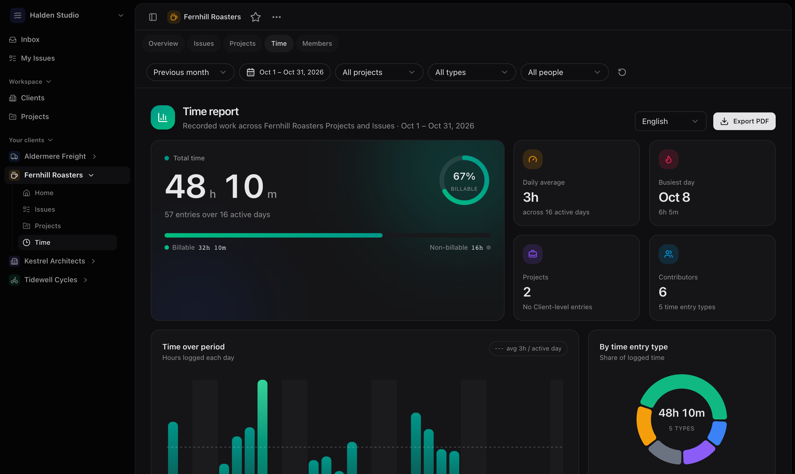
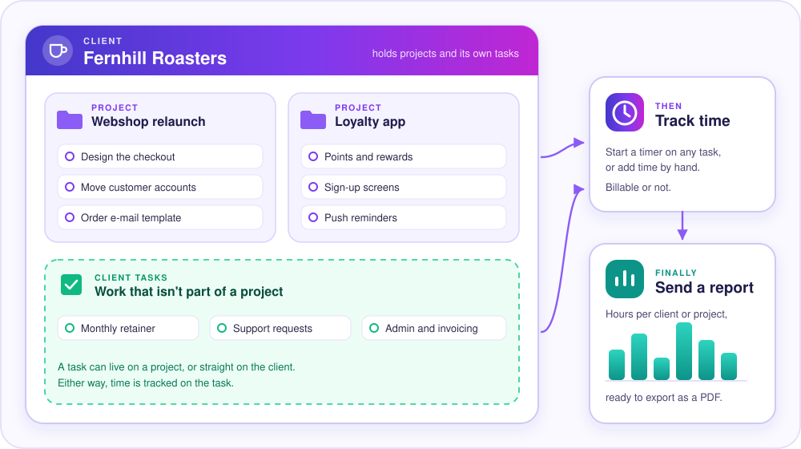
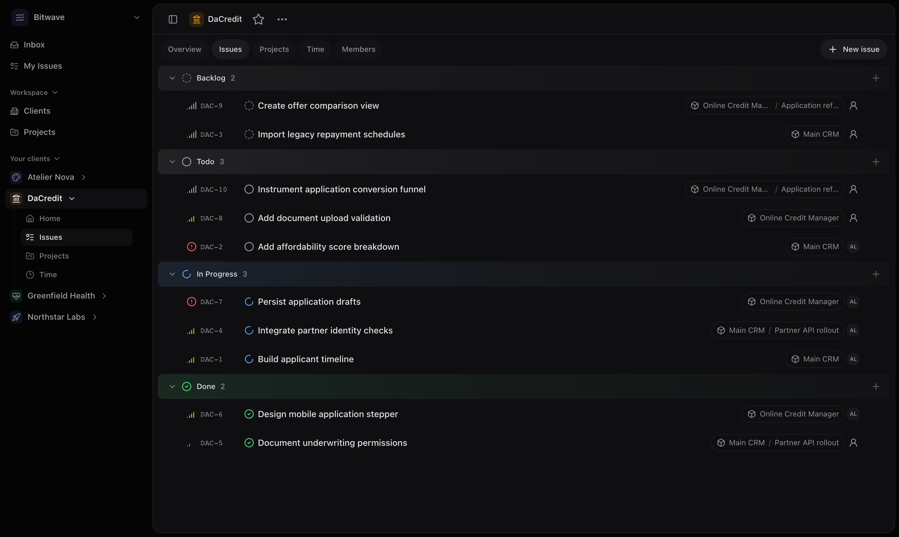
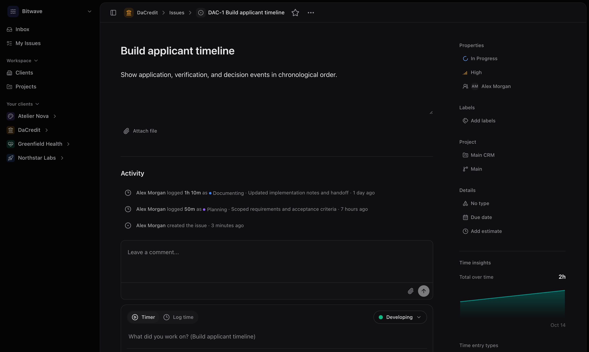
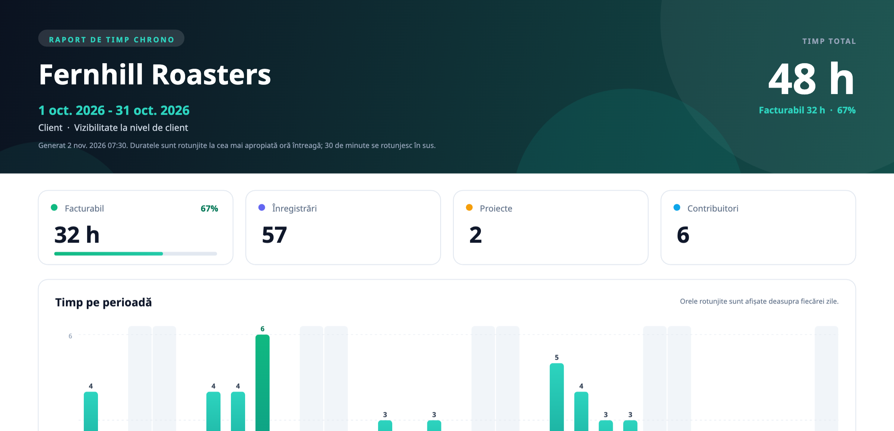

<p align="center">
  
</p>

<h1 align="center">Chrono</h1>

<p align="center">
  <b>Track the time. Keep your clients happy.</b><br>
  A self-hosted workspace for agencies and small teams that bill by the hour.
</p>

<p align="center">
  <a href="#install-in-three-steps">Install</a> ·
  <a href="#how-chrono-works">How it works</a> ·
  <a href="#what-you-get">What you get</a> ·
  <a href="#a-quick-look">Screenshots</a> ·
  <a href="#updates-and-backups">Updates</a>
</p>

<p align="center">
  
</p>

## Why Chrono

You keep your clients, projects, and tasks in one place, track the time spent
on them, and send clients a clear report when it's time to invoice. No
spreadsheets, no juggling three different tools.

- 🏠 **It's yours.** Chrono runs on your own server, so your data stays with
  you.
- 🆓 **It's free to host yourself.** No per-seat pricing.
- ⚡ **It's quick.** Made to be used from the keyboard, with a compact layout
  and a light and dark theme.
- 📱 **It works on your phone**, too.

## How Chrono works

Everything starts with a **client**. A client has **projects**, and it can also
hold tasks that don't belong to any project, like a monthly retainer or
support. Whichever way you organize it, time is tracked on a task, and it adds
up to the right project and client for you.

<p align="center">
  
</p>

## What you get

<table>
  <tr>
    <td width="50%" valign="top"><b>🧩 Clients, projects, and tasks</b><br>Assign people, add labels, comments, and file attachments, and group work by status.</td>
    <td width="50%" valign="top"><b>⏱️ Time tracking</b><br>Start a timer or add time by hand. Mark it billable or not, and sort it with your own entry types.</td>
  </tr>
  <tr>
    <td width="50%" valign="top"><b>📊 Reports you can send</b><br>Every client and project has a Time tab: total hours, billable share, a day-by-day chart, and breakdowns by type, project, and person.</td>
    <td width="50%" valign="top"><b>📄 A polished PDF</b><br>Export the report for your client, in English or Romanian.</td>
  </tr>
  <tr>
    <td width="50%" valign="top"><b>👥 Your team and your clients</b><br>Invite teammates as owners, admins, or members. Give clients limited guest access to only what they should see.</td>
    <td width="50%" valign="top"><b>📥 An inbox</b><br>See assignments, status changes, and comments addressed to you.</td>
  </tr>
  <tr>
    <td width="50%" valign="top"><b>🧹 Fix mistakes</b><br>Tracked time by accident? Owners and admins can delete an entry, and it drops out of every report.</td>
    <td width="50%" valign="top"><b>🔒 Private by design</b><br>Your data lives in a database and file store on your own machine.</td>
  </tr>
</table>

## A quick look

| Issues for a client, grouped by status | One issue, with its activity and a timer |
| --- | --- |
|  |  |

The PDF report you can send to a client (the first page, shown here in Romanian):



## Install in three steps

You need a computer or server that can run [Docker](https://docs.docker.com/get-docker/)
(Docker Desktop works too). Nothing else needs to be installed.

**1. Run the installer**

```sh
curl -fsSL https://raw.githubusercontent.com/bitwave-md/chrono/main/scripts/install.sh | sh
```

It sets everything up in a `chrono` folder in your home directory, generates
the passwords it needs, and starts Chrono at `http://localhost:3000`.

**2. Create your account**

Open `http://localhost:3000/auth/setup` and enter the setup code the installer
printed. (It's also saved in `~/chrono/.env` if you need it again.) Choose the
email and password you'll use to sign in. You become the first owner.

**3. Invite your team**

Add teammates from the workspace settings. Chrono doesn't send emails, so
invitation links are copied and shared by you directly.

## Put it on your own domain

To make Chrono available at an address like `https://chrono.example.com`, point
that domain at your server and run the installer with your address. Chrono sets
up and renews the HTTPS certificate automatically (ports 80 and 443 need to be
open).

```sh
curl -fsSL https://raw.githubusercontent.com/bitwave-md/chrono/main/scripts/install.sh |
  NEXTAUTH_URL=https://chrono.example.com sh
```

Already have a reverse proxy such as Nginx, Traefik, or Caddy? Skip the
built-in HTTPS, set `NEXTAUTH_URL` to your address, and proxy to Chrono's local
port.

## Updates and backups

**Updating.** When a new version is available, Chrono tells whoever
administers the installation. Open **Settings → Updates** and click one
button: Chrono makes a backup, installs the new version, and checks that
everything works. If something goes wrong, it rolls back to the version you
had.

**Backing up.** Run this on your server whenever you like:

```sh
cd ~/chrono
./backup.sh
```

A backup includes your database and all uploaded files. Keep copies somewhere
other than the server itself, and try a restore now and then so you know it
works. Restoring is covered in the [operations guide](docs/OPERATIONS.md).

## Good to know

- Chrono doesn't send email. You sign in with an email address and password,
  and invitation and password-reset links are copied and shared by an admin.
- Settings → Storage and Updates (for the installation's administrator) show
  the health of your installation.

<details>
<summary><b>For developers and advanced setups</b></summary>

<br>

- **Under the hood:** one Next.js application and a PostgreSQL database, with
  uploaded files in a private object store (the built-in one, or your own
  S3-compatible storage).
- **Manual Docker Compose setup, external S3 storage, and recovery steps:**
  [docs/OPERATIONS.md](docs/OPERATIONS.md)
- **Run it from source:**

  ```sh
  cp .env.example .env   # then replace the placeholder secrets
  npm run stack:up
  ```

  Chrono opens at `http://localhost:3000`. See
  [docs/OPERATIONS.md](docs/OPERATIONS.md#local-development-stack) for details.

More documentation:

- [Architecture](docs/ARCHITECTURE.md): how Chrono is put together
- [Operations](docs/OPERATIONS.md): installing, updating, backing up, and recovering
- [Releases](docs/RELEASES.md): how versions are published
- [Security](docs/SECURITY.md): authentication and deployment notes
- [API](docs/API.md): HTTP endpoints
- [Performance](docs/PERFORMANCE.md): measured performance notes
- [UX](docs/UX.md) and [UI standards](docs/UI_STANDARDS.md): interface conventions
- [Roadmap](roadmap.md): what has been built so far

</details>

## License

Chrono is made by [Bitwave Software](https://github.com/bitwave-md) and is free
to use, read, and modify for non-commercial purposes, as long as you credit
Bitwave Software. Commercial use, redistribution, and selling it need written
permission. See [LICENSE](LICENSE) for the full terms, or contact
daniil@btw.md for commercial licensing.
